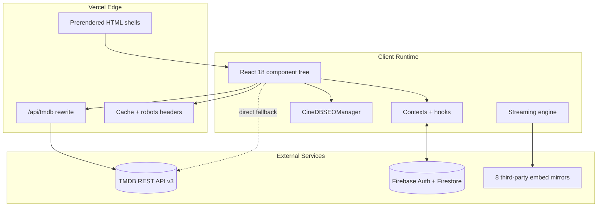
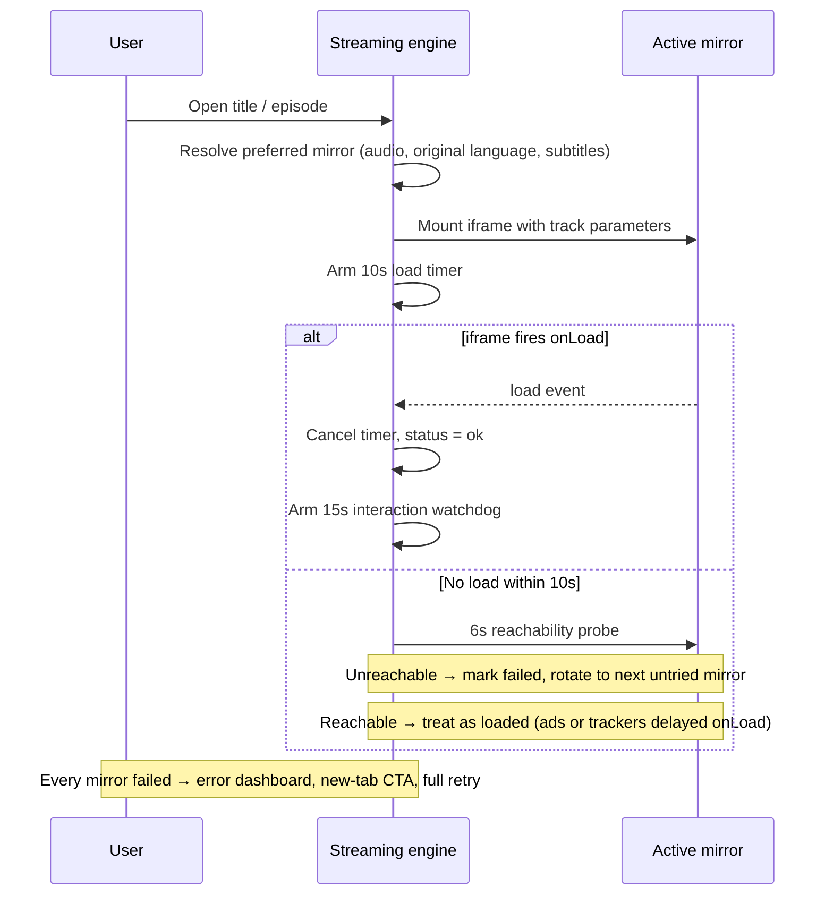

# 🏛️ CineDB — System Architecture & Technical Specifications

> **Author:** Makoju Suman Kumar  
> **Repository:** [CineDB.xyz](https://github.com/Msumankumar05/CineDB.xyz)  
> **Live Site:** [cinedb.xyz](https://www.cinedb.xyz)  
> **Last Updated:** October 27, 2026

---

## 📑 Table of Contents

1. [Architectural Overview](#1-architectural-overview)
2. [Component & Route Topology](#2-component--route-topology)
3. [State Management Layer](#3-state-management-layer)
4. [External API Integrations](#4-external-api-integrations)
5. [Streaming Failover Engine](#5-streaming-failover-engine)
6. [Audio & Subtitle Track Routing](#6-audio--subtitle-track-routing)
7. [Cloud Firestore Data Model & Security](#7-cloud-firestore-data-model--security)
8. [Programmatic SEO Lifecycle](#8-programmatic-seo-lifecycle)
9. [Performance & Asset Pipeline](#9-performance--asset-pipeline)
10. [Edge Configuration & Deployment](#10-edge-configuration--deployment)
11. [Operational Constraints](#11-operational-constraints)

---

## 1. Architectural Overview

CineDB is a **static React SPA with serverless edge routing**. There is no application server to operate: Vercel serves the build output, rewrites a single API path to TMDB, and Firebase provides identity and persistence directly to the browser.



**Design principles**

- **Static-first delivery** — the browser receives a real HTML shell for entity and category pages.
- **No backend surface** — auth, data, and file access are handled by Firebase SDKs under security rules.
- **Fail open on metadata** — TMDB traffic switches between proxy and direct endpoints automatically.
- **Fail over on playback** — every stream attempt has a timeout, a reachability probe, and a next mirror.
- **Progressive enhancement** — crawlers and link-preview bots see meaningful HTML; users get the full SPA.

---

## 2. Component & Route Topology

Routing uses `react-router-dom` v6 with route-level lazy loading:

| Route | Component | Access | Index policy |
|---|---|---|---|
| `/` | `Home.jsx` | Public | `index, follow` |
| `/movie/:id` | `MovieDetails.jsx` | Public | `index, follow` |
| `/tv/:id` | `MovieDetails.jsx` | Public | `index, follow` |
| `/series/:id` | `MovieDetails.jsx` | Public | `index, follow` (canonical → `/tv/:id`) |
| `/person/:id` | `ActorDetails.jsx` | Public | `index, follow` |
| `/category/:category` | `Category.jsx` | Public | `index, follow` for configured hubs with default params |
| `/category/genre?genre=:id` | `Category.jsx` | Public | `index, follow` for a single genre + default params |
| `/watch/:type/:id`, `/watch/:id` | `Watch.jsx` | Public | `noindex, follow` |
| `/search` | `Search.jsx` | Public | `noindex, follow` |
| `/login`, `/register`, `/forgot-password` | `Auth/*.jsx` | Guests | `noindex, follow` |
| `/verify-email` | `VerificationScreen.jsx` | Pending users | `noindex, follow` |
| `/profile` | `Profile.jsx` | Protected + verified | `noindex, follow` |
| `/watchlist` | `Watchlist.jsx` | Protected + verified | `noindex, follow` |
| `/terms`, `/privacy`, `/contact` | Static pages | Public | `index, follow` |
| `*` | `NotFound.jsx` | Public | `noindex, follow` |

**Shell composition**

```
ThemeProvider
└── AuthProvider
    └── ToastProvider
        └── WatchlistProvider
            └── ReviewsProvider
                └── Router
                    ├── ScrollToTop
                    ├── RouteSEOPolicy
                    ├── Navbar
                    ├── AppRoutes (lazy + Suspense)
                    ├── Footer (hidden on auth routes)
                    └── MobileBottomNav
```

`RouteSEOPolicy` computes indexability from the pathname and query string. Listings with non-default sort/page parameters, arbitrary category names, and any private route are marked `noindex, follow`.

---

## 3. State Management Layer

State is split into five focused contexts plus three reusable hooks. No external state library is used.

| Module | Responsibility |
|---|---|
| **`AuthContext`** | Firebase session, user profile shape, `emailVerified`, pending verification email, login/logout, provider sign-in, password reset |
| **`WatchlistContext`** | Real-time `onSnapshot` subscription to `users/{uid}/watchlist`, derived ID set, add/remove/toggle operations with verification guards |
| **`ReviewsContext`** | Per-title review subscription, aggregate rating, rating distribution, create/edit/delete, likes, replies |
| **`ThemeContext`** | Persists `cinedb_theme` and applies `data-theme` to the document root; production defaults to dark |
| **`ToastContext`** | Global transient notifications with type-specific styling |

**Hooks**

- `useDebounce` — delays navbar typeahead queries.
- `useLocalStorage` — persistence helper for small UI preferences.
- `useUpdateWatchHistory` — merges a watch-session document into `users/{uid}/watchHistory` with `setDoc(..., { merge: true })`.

**Local persistence keys**

| Key | Purpose |
|---|---|
| `cinedb_audio_language` | Audio preference (`auto` = title's original language) |
| `cinedb_subtitle_language` | Subtitle preference (default `en`) |
| `cinedb_theme` | Theme preference |

---

## 4. External API Integrations

### TMDB v3 — catalogue and metadata

- **Client base URL:** `/api/tmdb` (same origin) by default; `VITE_TMDB_BASE_URL` can override it.
- **Production:** `vercel.json` rewrites `/api/tmdb/:path*` to `https://api.themoviedb.org/3/:path*`.
- **Development:** Vite proxies the same path and resolves TMDB through public DNS (`8.8.8.8`, `1.1.1.1`) to bypass Indian ISP DNS poisoning.
- **Fallback:** if the proxy fails (network error, 404, or 5xx), the client retries the direct TMDB endpoint; if the direct endpoint is blocked, it falls back to the proxy.
- **Retry policy:** 8s timeout per attempt, two exponential-backoff retries (1s, 2s).
- **Images:** `https://image.tmdb.org/t/p` with responsive sizes (`w185`, `w342`, `w500`, `w780`, `w1280`).

**Endpoint surface**

- Lists: popular, top rated, upcoming, now playing, trending, on the air.
- Discovery: language, genre, year range, minimum rating, sort order.
- Detail: credits, videos, similar, recommendations, and watch providers; TV detail additionally requests content ratings and external IDs.
- Season detail: episode lists and counts.
- Search: multi-search filtered to movies and TV.

### Firebase

- **Authentication:** Google, Facebook, email/password, verification emails, password reset.
- **Firestore:** watchlist, watch history, reviews, and user profile documents.
- **Rules:** see [section 7](#7-cloud-firestore-data-model--security).

### Vercel Analytics

`inject()` runs before React mounts so the first page view is captured. It is first-party, cookieless page-view measurement — no advertising or data-broker scripts are present.

---

## 5. Streaming Failover Engine

### Mirror registry

Order is language-dependent; the table lists the global/Western default order.

| # | ID | Movie URL shape | Track support |
|---|---|---|---|
| 1 | `vidlink` | `vidlink.pro/movie/{id}` | `selectedLanguage`, `multiLang` |
| 2 | `autoembed` | `autoembed.co/movie/tmdb/{id}` | None |
| 3 | `videasy` | `player.videasy.to/movie/{id}` | None |
| 4 | `vidsrcparty` | `vidsrc.party/embed/movie/{id}` | `sub` (ISO code) |
| 5 | `2embedcc` | `2embed.cc/embed/{id}` | None |
| 6 | `vidsrcpm` | `vidsrc.pm/embed/movie/{id}` | None |
| 7 | `2embedskin` | `2embed.skin/embed/{id}` | None |
| 8 | `embedwave` | `embedwave.cc/embed/movie/{id}` | None |

Most TV mirrors follow `/tv/{id}/{season}/{episode}`. The exceptions are AutoEmbed (`tv/tmdb/{id}-{season}-{episode}`) and both 2Embed hosts (`embedtv/{id}&s={season}&e={episode}`).

### Failure lifecycle



**Key behaviours**

- **Next-mirror preconnect** — DNS/TLS is warmed for the next mirror in the rotation to cut failover latency.
- **Wraparound search** — `findNextServerIndex` checks every untried mirror, not just those after the current index.
- **Attempt generation guard** — a monotonic attempt counter prevents a stale preflight result from overriding a newer manual switch.
- **Late language re-route** — if `original_language` arrives after mount, the engine re-routes only while the viewer has not interacted with the player.
- **Interaction watchdog** — entering the iframe blurs the parent window; if that never happens within 15s, the UI offers *"Try next source"*.
- **Hidden mirror names** — viewers see `Stream Online` / `Switching source…` and an `Auto-Failover` pill, never server labels.

---

## 6. Audio & Subtitle Track Routing

The embed ecosystem exposes very little track control. CineDB uses the two parameters that are verified to work and routes everything else by mirror capability.

### Resolution pipeline

1. `audioLang` is read from `cinedb_audio_language`.
2. `resolveAudioCode()` maps `auto` to the title's TMDB `original_language`.
3. `languageName()` converts the ISO code to the English label VidLink expects.
4. `isDubbedChoice()` decides whether `multiLang=true` should be sent.
5. `getPreferredServerIndex()` chooses a mirror order:

| Condition | Order |
|---|---|
| Non-English subtitle choice | `vidsrcparty → videasy → embedwave → 2embedcc → vidsrcpm → 2embedskin → autoembed → vidlink` |
| Indian audio or Indian title | `vidsrcparty → embedwave → videasy → 2embedcc → 2embedskin → vidsrcpm → autoembed → vidlink` |
| Everything else | `vidlink → autoembed → videasy → vidsrcparty → 2embedcc → vidsrcpm → 2embedskin → embedwave` |

### Parameter contract

| Mirror | Parameter | Notes |
|---|---|---|
| VidLink | `selectedLanguage=<lowercase name>` | Case-sensitive label match inside the player; lowercase is mandatory |
| VidLink | `multiLang=true` | Only when the viewer explicitly chooses a dub |
| vidsrc.party | `sub=<iso>` | Only mirror with a working subtitle selector; used for non-English choices |
| Others | None | Changing only subtitles does not reload these mirrors |

**Verified behaviour**

- `?selectedLanguage=japanese` starts a Japanese title on its original track.
- `?selectedLanguage=english&multiLang=true` exposes the English dub.
- `vidsrc.party` serves ISO-coded subtitle tracks and `sub=en` sets English tracks to `showing`.

**Limits**

- Tracks exist only where the upstream catalogue provides them.
- The in-player CC/⚙ menus remain the final fallback and are referenced in the UI copy.

---

## 7. Cloud Firestore Data Model & Security

### Document schema

```
users/{uid}
  ├── watchlist/{type_id}              # e.g. movie_550, tv_1399
  │     id, itemId, media_type, title, name, poster_path, backdrop_path,
  │     vote_average, release_date, first_air_date, overview, addedAt
  │
  └── watchHistory/{type_id}
        mediaId, title, posterPath, type, timestamp,
        seasonNumber (TV), episodeNumber (TV)

movies/{movieId}/reviews/{uid}
      userId, userName, userAvatar, movieId, rating, title, content,
      createdAt, editedAt, likes, likedBy[], replies[]
```

### Security model

```javascript
function isSignedIn() { return request.auth != null; }
function isVerified() {
  return isSignedIn() && request.auth.token.email_verified == true;
}
function isOwner(uid) {
  return isSignedIn() && request.auth.uid == uid;
}
```

| Collection | Read | Write |
|---|---|---|
| `users/{uid}` | Any signed-in user | Owner only |
| `users/{uid}/watchlist/*` | Verified owner | Verified owner |
| `users/{uid}/watchHistory/*` | Verified owner | Verified owner |
| `movies/{id}/reviews/*` | Any signed-in user | Create: verified, doc ID = UID. Update/delete: verified owner |
| Everything else | Denied | Denied |

**Why verification is enforced twice:** the client blocks unverified accounts from mutating data for a clean UX, while Firestore rules enforce the same constraint at the trust boundary. Rules are the source of truth.

**Document ID strategy:** `{type}_{tmdbId}` for user data and `{uid}` for reviews. This makes idempotent writes trivial, prevents duplicate reviews, and allows a single `deleteDoc` to remove an item without a query.

---

## 8. Programmatic SEO Lifecycle

CineDB runs two complementary SEO layers.

### A. Runtime head management (`src/utils/seo.js`)

`CineDBSEOManager` exposes:

- `setMovie(movie)` — watch-page metadata with canonical to `/movie/:id`.
- `setTvEpisode(series, season, episode)` — episode metadata with canonical to `/tv/:id`.
- `setPage({...})` — generic title/description/canonical/OG/Twitter for static and category pages.
- `setRobots(content)` — route-level index policy.
- `reset()` — restores baseline tags on unmount.

It mutates existing tags rather than duplicating them, truncates descriptions at 160 characters, and replaces any prerendered JSON-LD carrying `data-cinedb-schema` so hydration does not leave stale structured data.

### B. Build-time prerendering (`scripts/generate-sitemap.js`)

Runs after `vite build`:

1. Reads `VITE_TMDB_API_KEY` from `process.env` or `.env`.
2. Fetches 7 TMDB endpoints × 3 pages each:
   - `/trending/movie/week`, `/movie/popular`, `/movie/top_rated`, `/movie/upcoming`
   - `/trending/tv/week`, `/tv/popular`, `/tv/top_rated`
3. Deduplicates by TMDB ID.
4. Writes `dist/sitemap.xml` with `<loc>`, `<lastmod>`, `<changefreq>`, `<priority>`, and Google Image extensions.
5. Writes `dist/movie/<id>.html`, `dist/tv/<id>.html`, and `dist/category/<id>.html` shells:
   - unique `<title>`, description, canonical, Open Graph, Twitter tags
   - `Movie` / `TVSeries` / `CollectionPage` JSON-LD
   - `BreadcrumbList`
   - `<noscript>` fallback content
6. Always generates the 18 category shells, even when no TMDB key is present.

`vercel.json` sets `"cleanUrls": true`, so `/movie/550` resolves to `movie/550.html` before the SPA rewrite applies. `public/sitemap.xml` is only a committed fallback; the deployed file is the generated `dist/sitemap.xml`.

### C. Index hierarchy

| URL class | Canonical target | Index policy |
|---|---|---|
| `/movie/:id` | itself | index |
| `/tv/:id` | itself | index |
| `/series/:id` | `/tv/:id` | index (canonicalised) |
| `/person/:id` | itself | index |
| `/category/:id` | itself | index with default params |
| `/watch/*` | `/movie/:id` or `/tv/:id` | noindex |
| `/search?q=*` | `/search` | noindex |
| Auth, profile, watchlist | — | noindex |

---

## 9. Performance & Asset Pipeline

- **Route-level splitting** — every page is loaded through `React.lazy` + `Suspense`.
- **Vendor chunk strategy** (`vite.config.js`):
  - `vendor-react` — React, React DOM, React Router, Scheduler
  - `vendor-firebase` — Firebase packages
  - `vendor-misc` — Axios, date-fns, remaining dependencies
- **Cache policy** — `/assets/*` is immutable for one year; the sitemap is cached for an hour at the edge with a one-day stale window.
- **Image strategy** — fixed aspect ratios, TMDB CDN resizing, poster-first fallbacks, and no layout shift on shelves.
- **Font strategy** — Inter and Outfit with `display=swap`, preconnected origins.
- **CSS strategy** — hand-written, token-driven CSS. No runtime CSS-in-JS and no component library.
- **Player warm-up** — preconnect to the active and next mirror origins.

The result is a small application entry chunk with stable vendor caching, which keeps repeat visits fast even on mid-range mobile devices.

---

## 10. Edge Configuration & Deployment

### Vercel

| Concern | Configuration |
|---|---|
| Canonical host | `cinedb.xyz/*` → `https://www.cinedb.xyz/*`, status 308 |
| Clean URLs | `cleanUrls: true` so prerendered `.html` files win over rewrites |
| TMDB proxy | `/api/tmdb` and `/api/tmdb/:path*` rewritten to TMDB v3 |
| SPA fallback | Explicit rewrites per route plus a catch-all |
| Robots headers | `noindex, follow` on `/search`, `/watch/*`, auth, `/profile`, `/watchlist` |
| Asset caching | `public, max-age=31536000, immutable` |
| Analytics origin | Vercel first-party analytics |

### Build pipeline

```bash
npm run build
# vite build
# node scripts/generate-sitemap.js
#   → dist/sitemap.xml
#   → dist/movie/<id>.html
#   → dist/tv/<id>.html
#   → dist/category/<id>.html
#   → dist/404.html
```

Deployment is triggered automatically from `main`. Firebase Hosting is also configured (`firebase.json`) as an alternate static target with equivalent rewrites and headers.

### Environment variables

```env
VITE_TMDB_API_KEY=
# Optional — defaults to the same-origin /api/tmdb proxy
VITE_TMDB_BASE_URL=
VITE_TMDB_IMAGE_BASE_URL=https://image.tmdb.org/t/p
VITE_FIREBASE_API_KEY=
VITE_FIREBASE_AUTH_DOMAIN=
VITE_FIREBASE_PROJECT_ID=
VITE_FIREBASE_STORAGE_BUCKET=
VITE_FIREBASE_MESSAGING_SENDER_ID=
VITE_FIREBASE_APP_ID=
```

The TMDB key is also required in the build environment so the sitemap and prerender steps can fetch catalogue data.

---

## 11. Operational Constraints

1. **Third-party catalogue coverage** — no mirror carries every title, language, or subtitle track. Routing improves the odds; it cannot create missing media.
2. **Iframe opacity** — cross-origin embeds cannot be inspected. The engine infers health from load events, reachability probes, and user interaction rather than DOM state.
3. **Sitemap is a catalogue snapshot** — it covers the trending/popular/top-rated/upcoming windows at build time, not the entire TMDB database. Rebuilds refresh it.
4. **Review reads require authentication** — Firestore rules intentionally restrict review reads to signed-in users.
5. **Analytics is intentionally minimal** — page views only; no behavioural profiling.
6. **Self-service account deletion** is on the roadmap; the current profile screen exposes sign-out and account controls, with deletion planned as a complete data-erasure flow.

---

<div align="center">
  <p><strong>CineDB Architecture Documentation © 2026 Makoju Suman Kumar</strong></p>
</div>
