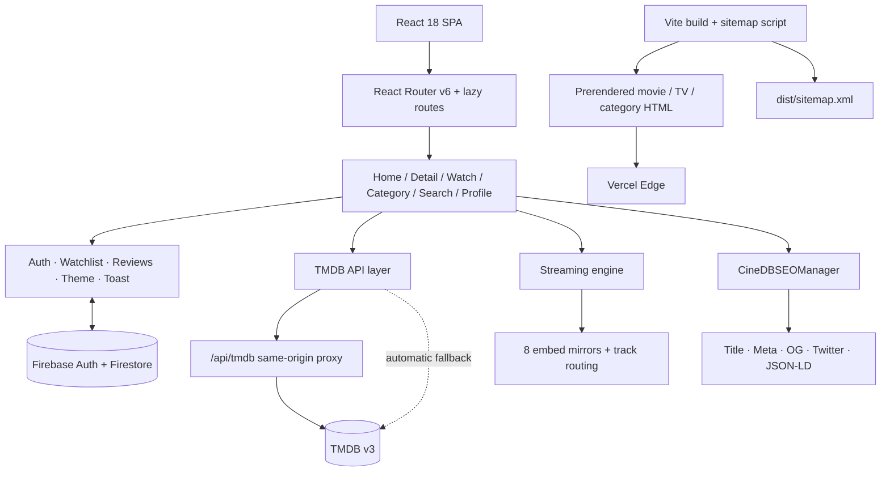

<div align="center">


# 🎬 CineDB — The Modern Cinematic Universe

<p align="center">
  <strong>An India-first entertainment discovery engine and streaming companion built with React 18, Vite 5, TMDB v3, and Firebase.</strong>
</p>

<p align="center">
  <a href="https://www.cinedb.xyz"></a>
  <a href="https://www.cinedb.xyz"></a>
  <a href="https://vitejs.dev/"></a>
  <a href="https://react.dev/"></a>
  <a href="https://firebase.google.com/"></a>
  <a href="https://developer.themoviedb.org/"></a>
</p>

<p align="center">
  <a href="https://www.cinedb.xyz"><strong>🌐 Launch CineDB Live (cinedb.xyz)</strong></a>
  &nbsp;&nbsp;•&nbsp;&nbsp;
  <a href="https://itsmsk.vercel.app/"><strong>👤 Developer Portfolio</strong></a>
  &nbsp;&nbsp;•&nbsp;&nbsp;
  <a href="mailto:ms.kumar.developer05@gmail.com"><strong>📫 Get in Touch</strong></a>
  &nbsp;&nbsp;•&nbsp;&nbsp;
  <a href="#-system-architecture"><strong>📐 Architecture</strong></a>
</p>

<br />

> *"Track what you love, discover what's next, obsess over filmographies, and start every stream in the right language — inside an OLED-optimized, glassmorphic interface."*

</div>

---

## 📑 Table of Contents

- [Executive Summary](#-executive-summary)
- [Key Highlights](#-key-highlights)
- [System Architecture](#-system-architecture)
- [Detailed Feature Breakdown](#-detailed-feature-breakdown)
  - [1. Real-Time Global Search](#1-real-time-global-search)
  - [2. Indian Cinema Taxonomy](#2-indian-cinema-taxonomy)
  - [3. Three-Tab Recommendation Engine](#3-three-tab-recommendation-engine)
  - [4. Adaptive Eight-Mirror Streaming Engine](#4-adaptive-eight-mirror-streaming-engine)
  - [5. Original Audio & Subtitle Control](#5-original-audio--subtitle-control)
  - [6. Watch Experience & Continuity](#6-watch-experience--continuity)
  - [7. Cloud-Synced Watchlist & History](#7-cloud-synced-watchlist--history)
  - [8. Community Review Engine](#8-community-review-engine)
  - [9. Actor & Talent Profiles](#9-actor--talent-profiles)
  - [10. Multi-Provider Authentication](#10-multi-provider-authentication)
  - [11. Programmatic SEO & Prerendered Pages](#11-programmatic-seo--prerendered-pages)
- [Tech Stack & Engineering Standards](#-tech-stack--engineering-standards)
- [Performance & Core Web Vitals](#-performance--core-web-vitals)
- [Security, Isolation & Privacy](#-security-isolation--privacy)
- [Project Directory Layout](#-project-directory-layout)
- [Local Setup & Deployment](#-local-setup--deployment)
- [Roadmap & Milestones](#-roadmap--milestones)
- [Developer & Copyright](#-developer--copyright)

---

## 🌟 Executive Summary

**CineDB** is a production-deployed cinematic discovery platform and playback companion. It pairs a bespoke, dependency-light React front end with a resilient streaming layer designed for real-world Indian carrier networks.

The product is built around three ideas:

1. **Discovery should feel instant.** TMDB's global catalogue, Indian regional hubs, curated shelves, and a three-tab recommendation engine make browsing fast and contextual.
2. **Playback should not dead-end.** Eight embed mirrors, post-timeout reachability checks, automatic rotation, and a stuck-stream escape hatch keep the experience moving when a carrier blocks a host.
3. **The experience should respect the film.** Titles default to their original audio track, subtitles start in English where available, and regional subtitle choices route to the mirror that can actually apply them.

Everything is wrapped in a custom OLED-dark interface with a gold accent system, responsive shelves, and a mobile bottom navigation bar — no heavyweight component library.

---

## 🚀 Key Highlights

| Highlight | Description |
|---|---|
| 🎧 **Original audio by default** | "Original" resolves to each title's TMDB `original_language`; foreign films no longer start on the English dub. |
| 💬 **Subtitle language control** | A first-class subtitle picker (English default-on, 17 languages + source default/off) with automatic routing to the only mirror that honours subtitle parameters. |
| 🛰️ **Eight-mirror failover engine** | 10s load timeout, 6s post-timeout reachability probe, 15s stuck-stream watchdog, silent auto-rotation, and a full retry. Mirror names stay hidden from viewers. |
| 🇮🇳 **India-first catalogue** | Dedicated Telugu, Hindi, Tamil, Malayalam, and combined Indian cinema hubs, plus regional TV series. |
| 🎯 **Three-tab recommendations** | *Recommended For You*, *Similar Titles*, and *Top Rated* with carousel and grid modes. |
| ☁️ **Cloud watchlist + history** | Firestore-backed watchlist and watch history; TV cards record and display the last watched season and episode. |
| 🚀 **Build-time prerendering** | Static HTML shells for movie, TV, and category pages with per-page meta, canonical, Open Graph, and JSON-LD — link previews work without JavaScript. |
| 🧠 **ISP-resilient TMDB access** | By default, client catalogue calls go through the same-origin `/api/tmdb` reverse proxy, with a direct-endpoint fallback and public-DNS resolver for local builds. |
| 🔐 **Three sign-in paths** | Google OAuth, Facebook login, and email/password with mandatory verification. |

---

## 📐 System Architecture



**Request path in production**

1. Vercel serves the prerendered HTML shell when one exists (`/movie/:id`, `/tv/:id`, `/category/:id`) and the SPA fallback everywhere else.
2. React hydrates, then `CineDBSEOManager` replaces the static schema with the richer runtime schema for the active page.
3. Catalogue data is fetched from `/api/tmdb/*`, rewritten at the edge to `https://api.themoviedb.org/3/*`.
4. The player mounts the best mirror for the title's language profile and rotates transparently if that mirror stalls.

---

## 🔍 Detailed Feature Breakdown

### 1. Real-Time Global Search

- **Debounced typeahead** in the navbar with poster thumbnails and instant navigation.
- **Full search page** at `/search?q=...` with paginated TMDB multi-search, filtered to movies and TV series.
- **Shareable URLs** — every query lives in the query string, so results can be linked or refreshed without state loss.
- **Empty, loading, and error states** designed in the same visual language as the rest of the app.

### 2. Indian Cinema Taxonomy

Dedicated, crawlable hubs for the regional industries that matter most to the target audience:

| Hub | Route | Filter |
|---|---|---|
| Tollywood | `/category/telugu` | `language=te` |
| Bollywood | `/category/hindi` | `language=hi` |
| Kollywood | `/category/tamil` | `language=ta` |
| Mollywood | `/category/malayalam` | `language=ml` |
| Pan-Indian | `/category/indian` | `hi\|te\|ta\|ml\|kn` |
| Regional series | `/category/telugu_series`, `/category/hindi_series` | TV + language |

The home page mirrors these as curated shelves, and the player's language-aware routing prioritises Indian-capable mirrors for Indian titles.

### 3. Three-Tab Recommendation Engine

The detail page ends with a context-aware recommendation surface rather than a single "More Like This" strip:

- **🎯 Recommended For You** — TMDB recommendation results blended with a genre-affinity score.
- **🎬 Similar Titles** — TMDB similarity graph for the current title.
- **⭐ Top Rated** — high-rated titles within the same genre space.

Each tab supports a **carousel** and **grid** view, shows item counts, and includes a one-tap watchlist toggle on every card.

### 4. Adaptive Eight-Mirror Streaming Engine

CineDB treats playback as a failover problem, not a single embed.

| Layer | Behaviour |
|---|---|
| **Reachability preflight** | 6s host check after a load timeout, before rotating |
| **Load timeout** | 10s per mirror |
| **Stuck-stream watchdog** | 15s without viewer interaction surfaces *"Try next source"* |
| **Rotation** | Automatic switch to the next mirror in the priority order |
| **Recovery** | `Retry Stream` resets every mirror after a total failure |
| **Fallback CTA** | Opens the stream in a new tab to escape carrier iframe inspection |
| **Episode navigator** | Season and episode pickers with accurate per-season episode counts |

The mirror registry is intentionally **hidden from the UI**: viewers see a clean player with an `Auto-Failover` status pill, not a wall of server names. Mirror priority is language-aware — Indian titles and Indian audio choices start on the source that actually carries them.

### 5. Original Audio & Subtitle Control

This is the headline playback feature of the current release.

**Audio**

- `Original` resolves to the title's TMDB `original_language`, so a Japanese, Korean, or Spanish film starts in that language.
- VidLink receives `?selectedLanguage=<lowercase language name>`. A lowercase value is required because the player matches track labels case-sensitively against a lowercased label.
- `?multiLang=true` is sent only when the viewer deliberately chooses a dub (audio ≠ original).
- Picking a different audio language never surprises the viewer: a toast states the requested track and points to the in-player settings if the source does not carry it.

**Subtitles**

- English is the default where the source provides it.
- The picker covers English, Hindi, Telugu, Tamil, Malayalam, Kannada, Bengali, Marathi, Spanish, French, German, Portuguese, Arabic, Russian, Japanese, Korean, and Chinese, plus **Source default** and **Off**.
- Non-English choices route to `vidsrc.party`, the only mirror with a working subtitle parameter (`?sub=<iso>`). Switching only the subtitle preference does **not** reload mirrors that cannot apply it.
- Preferences persist in `localStorage` (`cinedb_audio_language`, `cinedb_subtitle_language`).

> **Honest constraint:** embeds can only expose the tracks their own catalogues contain. CineDB forces the correct starting track and routes to the best source, but it cannot invent a dub or subtitle file that no mirror provides. The in-player CC/⚙ menus remain the fallback.

### 6. Watch Experience & Continuity

The `/watch/:type/:id` page is a dedicated playback environment:

- Full-width player with **Theater Mode** (lights-off overlay) and **Popout** to a new tab.
- Right-hand side panel with poster, rating, year, runtime or season/episode counts, and top cast.
- Tabs for **Overview**, **Cast**, and **Reviews** below the player.
- **Coming Soon** state for unreleased titles, with playback and theater mode disabled.
- History-aware TV links: `/watch/tv/:id?s=<season>&e=<episode>` carries the recorded position, and the card displays it as `S1 E3`.

### 7. Cloud-Synced Watchlist & History

- **Watchlist** lives at `users/{uid}/watchlist/{type_id}` and syncs in real time via Firestore `onSnapshot`, with toast feedback on every mutation.
- **Watch history** lives at `users/{uid}/watchHistory/{type_id}` and stores `mediaId`, `title`, `posterPath`, `type`, `timestamp`, and TV `seasonNumber` / `episodeNumber`.
- The **Recently Watched** row on the home page (signed-in users) shows episode badges and a one-tap return to the title.
- Both features require a **verified email**, enforced client-side and in Firestore security rules.

### 8. Community Review Engine

- **1–5 star ratings** with a labelled rating scale.
- **One review per user per title** (document ID = user UID), with full edit and delete support.
- **Rating distribution chart** computed from live review data.
- **Likes and threaded replies** on reviews.
- Reviews are readable by signed-in users and writable only by verified owners.

### 9. Actor & Talent Profiles

- Biography, birthday, birthplace, and known-for department.
- Complete filmography with department filters (acting vs. crew).
- Direct jumps between people, movies, and series.
- `Person` JSON-LD so filmography pages are eligible for entity rich results.

### 10. Multi-Provider Authentication

| Method | Flow |
|---|---|
| **Google OAuth** | One-tap popup sign-in |
| **Facebook Login** | One-tap popup sign-in |
| **Email & password** | Registration and sign-in with client-side validation |
| **Email verification** | Mandatory gate before watchlist, history, and review writes |
| **Password reset** | Emailed reset link via Firebase Auth |

Unverified accounts remain signed in but are routed to `/verify-email`, where verification is polled automatically and the email can be resent.

### 11. Programmatic SEO & Prerendered Pages

- **Build-time HTML shells** for `dist/movie/<id>.html`, `dist/tv/<id>.html`, and all 18 category hubs, each with a unique title, description, canonical, Open Graph/Twitter tags, `Movie` / `TVSeries` / `CollectionPage` JSON-LD, and a breadcrumb trail.
- **Runtime head management** via `CineDBSEOManager` for SPA navigation, including canonical correction to `/movie/:id` or `/tv/:id`.
- **Automatic sitemap** written to `dist/sitemap.xml` at build time — currently ~360 URLs (41 static/category/genre routes plus catalog-derived detail pages, depending on TMDB at build time).
- **Crawl hygiene** — `/watch/*`, `/search`, auth screens, `/profile`, and `/watchlist` are `noindex`; faceted listing URLs canonicalise away from the indexable hubs.
- **Apex consolidation** — `cinedb.xyz` permanently redirects (308) to `www.cinedb.xyz`.

---

## 💻 Tech Stack & Engineering Standards

```
Frontend
  ├── Core:         React 18.3 (Strict Mode)
  ├── Build:        Vite 5.4 (ESM, code splitting, manual vendor chunks)
  ├── Routing:      React Router DOM 6.30 (React.lazy + Suspense)
  ├── Styling:      Hand-written CSS3 (custom properties, no UI framework)
  └── HTTP:         Axios 1.13 (timeouts, retry interceptor, endpoint failover)

Cloud & Data
  ├── Auth:         Firebase Authentication (Google, Facebook, email/password)
  ├── Database:     Cloud Firestore with verified-only security rules
  ├── Hosting:      Vercel (edge rewrites, cache headers, clean URLs)
  ├── Analytics:    Vercel Analytics (first-party page views)
  └── Metadata:     TMDB v3 through the same-origin /api/tmdb proxy

Playback
  └── 8 third-party embed mirrors with client-side health checks and rotation
```

**Engineering conventions**

- No global state library: five focused React contexts cover auth, watchlist, reviews, theme, and toasts.
- Every route is lazily imported; heavy vendor code is split into independently cached chunks.
- TMDB access is wrapped in one API module with consistent errors, image helpers, and automatic endpoint switching.
- Player behaviour is configuration-driven: changing mirrors means editing the registry arrays, not the UI.

---

## ⚡ Performance & Core Web Vitals

- **Route-level code splitting** — home, detail, watch, category, search, profile, auth, and legal pages load on demand behind `Suspense`.
- **Stable vendor chunks** — `vendor-react`, `vendor-firebase`, and `vendor-misc` are cached independently from application code.
- **Immutable asset caching** — `/assets/*` is served with `Cache-Control: public, max-age=31536000, immutable`.
- **Responsive imagery** — `w342`/`w500` for cards, `w780`/`w1280` for heroes and social images, all from the TMDB image CDN.
- **Resource hints** — preconnect to the TMDB image CDN, the TMDB API host, and Google Fonts; DNS prefetch for YouTube thumbnails.
- **No layout-shifting overlays** — player states reserve the 16:9 canvas before the iframe loads.

---

## 🔒 Security, Isolation & Privacy

1. **Iframe isolation** — third-party players run in iframes with `referrerPolicy="no-referrer"`, a restricted `allow` list (autoplay, encrypted media, picture-in-picture), and native fullscreen.
2. **Verified-only writes** — Firestore rules require `email_verified == true` and ownership for watchlist, history, and reviews:
   ```javascript
   match /users/{userId}/watchlist/{itemId} {
     allow read, write: if isVerified() && isOwner(userId);
   }
   ```
3. **Owner-scoped reviews** — document IDs must equal the writer's UID, which enforces one review per user at the database level.
4. **No advertising or data-broker scripts** — the only analytics is Vercel's first-party page-view measurement.
5. **Minimal data model** — the app stores only what the product needs: account identity, watchlist items, watch history, and reviews.

---

## 📂 Project Directory Layout

```
CineDB/
├── public/
│   ├── cinedb.png                  # Brand asset
│   ├── robots.txt                  # Crawl directives
│   └── sitemap.xml                 # Static fallback (builds write dist/sitemap.xml)
├── scripts/
│   └── generate-sitemap.js         # Sitemap + prerendered HTML shells
├── src/
│   ├── api/
│   │   ├── auth.js                 # Firebase auth wrappers (Google, Facebook, email)
│   │   ├── firebase.js             # Firebase app / auth / Firestore initialisation
│   │   └── tmdb.js                 # TMDB client, proxy failover, image helpers
│   ├── components/
│   │   ├── dashboard/              # Recently Watched row
│   │   ├── Recommendations/        # Three-tab recommendation surface
│   │   ├── Reviews/                # Review form, cards, rating distribution
│   │   ├── streaming/              # Players, language pickers, mirror registries
│   │   ├── Navbar.jsx              # Header, typeahead search, dropdown menus
│   │   ├── Footer.jsx
│   │   ├── MobileBottomNav.jsx     # Native-feel mobile navigation
│   │   ├── MovieCard.jsx           # Poster card with rating + watchlist toggle
│   │   └── VerificationScreen.jsx  # Email verification gate
│   ├── context/
│   │   ├── AuthContext.jsx
│   │   ├── WatchlistContext.jsx
│   │   ├── ReviewsContext.jsx
│   │   ├── ThemeContext.jsx
│   │   └── ToastContext.jsx
│   ├── hooks/
│   │   ├── useDebounce.js
│   │   ├── useLocalStorage.js
│   │   └── useUpdateWatchHistory.js
│   ├── pages/
│   │   ├── Home.jsx                # Hero, quick filters, curated shelves
│   │   ├── MovieDetails.jsx        # Movie / TV detail hub
│   │   ├── Watch.jsx               # Playback environment, tabs, side panel
│   │   ├── Category.jsx            # Category and genre listing pages
│   │   ├── Search.jsx
│   │   ├── ActorDetails.jsx
│   │   ├── Watchlist.jsx
│   │   ├── Profile.jsx
│   │   ├── Auth/                   # Login, Register, Forgot Password
│   │   └── Contact.jsx, TermsOfService.jsx, PrivacyPolicy.jsx, NotFound.jsx
│   ├── styles/                     # Design tokens, themes, page styles
│   └── utils/
│       ├── constants.js            # Categories, genres, languages, sort options
│       └── seo.js                  # CineDBSEOManager runtime head engine
├── firestore.rules                 # Verified-only, owner-scoped security rules
├── firestore.indexes.json
├── vercel.json                     # Redirects, rewrites, headers, clean URLs
└── vite.config.js                  # Dev proxy and vendor chunk strategy
```

---

## 🛠️ Local Setup & Deployment

### Prerequisites

- **Node.js** 18 or newer
- **npm** 9 or newer
- A **TMDB API key** ([developer.themoviedb.org](https://developer.themoviedb.org/docs/getting-started))
- A **Firebase project** with Authentication and Firestore enabled

### Installation

> **Note:** the application source is proprietary and lives in a private repository. The commands below document how CineDB is built, configured, and deployed; running them requires repository access.

```bash
git clone https://github.com/Msumankumar05/CineDB.git
cd CineDB
npm install
cp .env.example .env
```

Configure `.env`:

```env
# TMDB
VITE_TMDB_API_KEY=your_tmdb_api_key_here
# Optional — leave unset to use the same-origin /api/tmdb proxy.
VITE_TMDB_BASE_URL=
VITE_TMDB_IMAGE_BASE_URL=https://image.tmdb.org/t/p

# Firebase
VITE_FIREBASE_API_KEY=your_firebase_api_key
VITE_FIREBASE_AUTH_DOMAIN=your_project.firebaseapp.com
VITE_FIREBASE_PROJECT_ID=your_project_id
VITE_FIREBASE_STORAGE_BUCKET=your_project.firebasestorage.app
VITE_FIREBASE_MESSAGING_SENDER_ID=your_sender_id
VITE_FIREBASE_APP_ID=your_app_id
```

> **Networking note:** the client calls TMDB through `/api/tmdb`. In development, Vite proxies that path using public DNS resolvers (`8.8.8.8`, `1.1.1.1`) to bypass Indian ISP DNS poisoning of `api.themoviedb.org`. In production, Vercel rewrites the same path at the edge.

### Scripts

```bash
npm run dev       # Vite dev server with the TMDB proxy
npm run build     # Production bundle + sitemap and prerendered shells
npm run preview   # Serve the production build locally
```

### Deployment

The repository deploys automatically to Vercel from `main`. The build step is `vite build && node scripts/generate-sitemap.js`, which writes `dist/sitemap.xml` and the prerendered `movie/`, `tv/`, and `category/` HTML files directly into the deployed output. `vercel.json` provides the apex→www 308 redirect, `cleanUrls`, SPA rewrites, and cache/noindex headers.

---

## 🗺️ Roadmap & Milestones

- [x] **Google, Facebook & email authentication** — three production sign-in paths
- [x] **Original audio + subtitle language control** — language-aware playback defaults and routing
- [x] **Eight-mirror failover engine** — preflight, timeouts, stuck-stream watchdog, retry
- [x] **Indian cinema taxonomy** — Telugu, Hindi, Tamil, Malayalam, and pan-Indian hubs
- [x] **Three-tab recommendations** — recommended, similar, and top rated
- [x] **Prerendered SEO architecture** — entity/category shells, JSON-LD, sitemap
- [x] **Watch history** — exact season and episode tracking with a Recently Watched row
- [ ] **Account deletion & data export** — self-service privacy controls
- [ ] **Public watchlist sharing** — shareable community lists
- [ ] **Push notifications** — new episode and release alerts
- [ ] **Progressive Web App** — offline shell and installable manifest
- [ ] **GitHub OAuth** — additional developer-friendly login option

---

## 📬 Developer & Copyright

**Built with passion by Makoju Suman Kumar**  
*Full-Stack Engineer & Designer*

- 🌐 **Portfolio:** [itsmsk.vercel.app](https://itsmsk.vercel.app/)
- 🐙 **GitHub:** [@Msumankumar05](https://github.com/Msumankumar05)
- 💼 **LinkedIn:** [in/itsmskdev](https://www.linkedin.com/in/itsmskdev/)
- ✉️ **Email:** [ms.kumar.developer05@gmail.com](mailto:ms.kumar.developer05@gmail.com)

---

### ⚖️ Copyright Notice

**Copyright © 2026 Makoju Suman Kumar. All rights reserved.**

*This showcase repository and its documentation are provided publicly for viewing, evaluation, and portfolio assessment purposes. The source code, UI designs, and original architectures are proprietary. Movie metadata and imagery are provided courtesy of [The Movie Database (TMDB)](https://www.themoviedb.org/). CineDB does not host, upload, or control third-party video streams.*

<br />

<div align="center">
  <a href="https://www.cinedb.xyz">
    
  </a>
</div>
