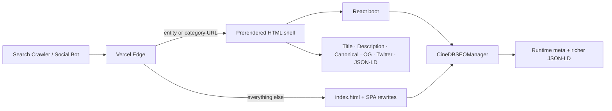

# 🎯 CineDB — Programmatic SEO & Search Engineering Strategy

> **Author:** Makoju Suman Kumar  
> **Domain:** [https://www.cinedb.xyz](https://www.cinedb.xyz)  
> **Technical Stack:** Vite + React SPA, build-time HTML prerendering, runtime head injection, Vercel edge routing

---

## 📑 Strategy Overview

Single-Page Applications usually lose search visibility because the first HTML response contains no page-specific content. CineDB solves this with a **two-layer SEO architecture**:

1. **Build-time prerendering** writes real HTML shells for movie, TV, and category pages — titles, descriptions, canonicals, Open Graph tags, and JSON-LD are present before JavaScript runs.
2. **Runtime head management** keeps metadata correct during client-side navigation and replaces the static schema with a richer entity graph after hydration.



This gives CineDB three wins:

- **Crawlable entity pages** without operating an SSR server.
- **Rich link previews** on WhatsApp, X, Telegram, Discord, and Slack.
- **No duplicate-content drift** between static and hydrated metadata, because runtime injection replaces the prerendered schema by marker.

---

## 1. Document Head & Primary Metadata

### Baseline head (`index.html`)

Every route inherits a complete baseline:

- **Canonical:** `https://www.cinedb.xyz/`
- **Robots:** `index, follow` by default, overridden per route
- **Open Graph:** site name, URL, title, description, image, image alt, type
- **Twitter:** `summary_large_image`, `@itsmskdev` attribution
- **Resource hints:** preconnect to the TMDB image CDN, the TMDB API host, and Google Fonts; DNS prefetch for YouTube thumbnails

### Structured data in the baseline

`index.html` ships a single `@graph` containing:

- `WebSite` with a `SearchAction` (`/search?q={search_term_string}`)
- `Organization` with logo, founder, and portfolio URL
- `SiteNavigationElement` listing the primary hubs (home, popular movies, trending series, top rated, Indian cinema)

Because this graph is global, it is safe to serve from every page and does not need to be re-injected at runtime.

### Runtime head manager (`src/utils/seo.js`)

`CineDBSEOManager` provides:

| Method | Used on | Canonical |
|---|---|---|
| `setMovie(movie)` | `/watch/movie/:id` | `/movie/:id` |
| `setTvEpisode(series, season, episode)` | `/watch/tv/:id` | `/tv/:id` |
| `setPage({...})` | Home, category, person, static, search | Route-appropriate |
| `setRobots(content)` | Global route policy | — |
| `reset()` | Unmount | `/` |

**Implementation details**

- Tags are updated in place with `getOrCreateMeta`, so repeated navigation cannot duplicate meta tags.
- Descriptions are truncated at 160 characters on a word boundary.
- Canonical targets always point at indexable entity pages, never at `/watch/*`.
- OG images use the wide TMDB backdrop where available, falling back to the poster.
- Runtime JSON-LD carries `data-cinedb-schema`, which the manager uses to replace — not stack — the prerendered schema.

---

## 2. Structured Data (JSON-LD)

### A. WebSite + Sitelinks Searchbox

The baseline `WebSite` schema advertises the search endpoint:

```json
{
  "@type": "WebSite",
  "@id": "https://www.cinedb.xyz/#website",
  "url": "https://www.cinedb.xyz/",
  "name": "CineDB",
  "potentialAction": {
    "@type": "SearchAction",
    "target": {
      "@type": "EntryPoint",
      "urlTemplate": "https://www.cinedb.xyz/search?q={search_term_string}"
    },
    "query-input": "required name=search_term_string"
  }
}
```

### B. Movie entities

`MovieDetails.jsx` builds an `@graph` for each movie:

- `Movie` — name, URL, image, description, release date, genres, and runtime for films
- `AggregateRating` — TMDB rating value, best/worst bounds, vote count
- `Person` — director and up to 12 billed actors, each linked to `/person/:id`
- `VideoObject` — the official trailer, nested as the entity's `trailer` property
- `WatchAction` + `Offer` — a free playback entry point for desktop and mobile web
- `BreadcrumbList` — Home → Movies → Title

Trailer metadata is promoted when a YouTube trailer exists, which makes the page eligible for video-rich results.

### C. TV entities

TV pages emit the same graph shape with `TVSeries` as the primary type, including:

- `numberOfSeasons` and `numberOfEpisodes`
- Series-level ratings and genres
- Episode-aware page titles from `setTvEpisode`

### D. Person pages

`Person` schema includes:

- `name`, `jobTitle` (known-for department), `birthDate`, `deathDate`, `birthPlace`
- Biography excerpt and IMDb `sameAs` linkage when available
- Known-for department and filmography count in the Twitter card labels

### E. Category and collection pages

Prerendered category shells emit:

- `CollectionPage` with the hub name, URL, and description
- `BreadcrumbList` — Home → Movies or TV Shows

### F. Prerendered entity shells

Each `dist/movie/<id>.html` and `dist/tv/<id>.html` contains a static graph built from TMDB list data: primary entity, `AggregateRating`, genres, image, and breadcrumb. After hydration, the runtime manager replaces it with the richer credit-aware graph.

---

## 3. Social Graph Protocol (Open Graph & Twitter Cards)

Every prerendered shell and every runtime navigation writes absolute, platform-safe values:

| Property | Content format | Example |
|---|---|---|
| `og:title` | `<Title> (<Year>) - Full <Type> Info, Cast, Trailer & Watch Online \| CineDB` | `Fight Club (1999) - Full Movie Info...` |
| `og:description` | Synopsis capped at 160 characters | Plot summary + genre hints |
| `og:image` | TMDB `w780` backdrop, poster fallback | `https://image.tmdb.org/t/p/w780/...jpg` |
| `og:image:alt` | Descriptive entity label | Poster and backdrop art |
| `og:type` | `video.movie`, `video.tv_show`, or `website` | `video.movie` |
| `og:url` | Canonical entity URL | `https://www.cinedb.xyz/movie/550` |
| `twitter:card` | `summary_large_image` | Large image card |
| `twitter:site` | `@itsmskdev` | Attribution |

**Why this matters:** messaging apps do not execute JavaScript. Without prerendered shells, a shared CineDB link would show the generic site title and logo. With shells, the preview shows the actual film, year, synopsis, and artwork.

---

## 4. Build-Time Prerendering Pipeline

`scripts/generate-sitemap.js` runs after `vite build` and produces both the sitemap and the HTML shells.

### Inputs

- `VITE_TMDB_API_KEY` from `process.env` or the project `.env`
- `dist/index.html` as the shell template

### Catalogue fetch

Seven endpoints × three pages each, deduplicated by TMDB ID:

- Movies: trending/week, popular, top_rated, upcoming
- TV: trending/week, popular, top_rated

Fetches use Axios with a custom HTTPS agent that resolves through Google/Cloudflare DNS, a 20s timeout, and up to three attempts. Individual page failures are tolerated so a transient error cannot empty the sitemap.

### Outputs

| Output | Content |
|---|---|
| `dist/sitemap.xml` | All static, category, genre, movie, and TV URLs with image extensions |
| `dist/movie/<id>.html` | Movie shell with meta, canonical, OG/Twitter, JSON-LD, noscript fallback |
| `dist/tv/<id>.html` | TV shell with the same contract |
| `dist/category/<id>.html` | 18 category hubs, always generated |
| `dist/404.html` | Noindex not-found page generated from the same template |

### Serving contract

`vercel.json` enables `"cleanUrls": true`, so a request for `/movie/550` maps to the static `movie/550.html` **before** the SPA rewrite. This ordering is what makes prerendering effective on Vercel.

### Why the output goes to `dist/`

`vite build` copies `public/` into `dist/` before the script runs. Writing to `public/sitemap.xml` after that copy would deploy the stale committed file. CineDB therefore writes directly to `dist/`, which is the directory Vercel deploys. The committed `public/sitemap.xml` remains only as a local/offline fallback.

---

## 5. Sitemap Strategy

### URL composition

| Class | Count | Priority | Changefreq |
|---|---|---|---|
| Homepage | 1 | 1.0 | daily |
| Legal / informational | 3 | 0.7 | monthly |
| Category hubs | 18 | 0.85 | daily |
| Genre landing pages | 19 | 0.75 | weekly |
| Movie entities | catalog-dependent | 0.8 | weekly |
| TV entities | catalog-dependent | 0.8 | weekly |

At the time of writing, production serves roughly **360 URLs** — 41 static/category/genre routes plus the catalog-derived entity pages. The exact count changes with each rebuild because it reflects TMDB's trending, popular, top-rated, and upcoming windows at build time.

### Image extensions

Entity URLs include Google Image sitemap tags:

```xml
<image:image>
  <image:loc>https://image.tmdb.org/t/p/w780/poster.jpg</image:loc>
  <image:title>Fight Club</image:title>
</image:image>
```

This gives image search a direct path to poster art without crawling every gallery.

### Freshness

`<lastmod>` is the build date. The sitemap is regenerated on every production deploy, so new trending titles enter the index without manual edits.

---

## 6. Crawl Budget & Index Directives

### `robots.txt`

```
User-agent: *
Allow: /
Allow: /movie/
Allow: /tv/
Allow: /series/
Allow: /person/
Allow: /category/
Allow: /terms
Allow: /privacy
Allow: /contact
Allow: /cinedb.png
Allow: /sitemap.xml

Disallow: /watchlist
Disallow: /profile
Disallow: /login
Disallow: /register
Disallow: /forgot-password
Disallow: /verify-email
Disallow: /watch/
Disallow: /search?*

Sitemap: https://www.cinedb.xyz/sitemap.xml
```

### HTTP headers

`vercel.json` (and the alternate `firebase.json`) add `X-Robots-Tag: noindex, follow` to:

- `/search`
- `/watch/*`
- `/login`, `/register`, `/forgot-password`, `/verify-email`
- `/profile`, `/watchlist`

Static assets receive `Cache-Control: public, max-age=31536000, immutable`; the sitemap is cached for an hour with a one-day stale window.

### Canonical hierarchy

| Request | Canonical | Index |
|---|---|---|
| `/movie/550` | `/movie/550` | ✅ |
| `/tv/1399` | `/tv/1399` | ✅ |
| `/series/1399` | `/tv/1399` | ✅ (canonicalised) |
| `/watch/movie/550` | `/movie/550` | ❌ noindex |
| `/watch/tv/1399` | `/tv/1399` | ❌ noindex |
| `/category/popular?page=2` | `/category/popular` | ❌ noindex (non-default params) |
| `/search?q=rrr` | `/search` | ❌ noindex |

### Host consolidation

`cinedb.xyz` returns a **308** redirect to `https://www.cinedb.xyz`, so every canonical, sitemap `<loc>`, and Open Graph URL shares one hostname. This avoids link-equity dilution and duplicate-host indexing.

### Route-level index policy

`RouteSEOPolicy` in `App.jsx` evaluates every navigation:

- Entity routes (`/movie/:id`, `/tv/:id`, `/series/:id`, `/person/:id`) are indexable.
- Configured category hubs are indexable only with default listing parameters.
- A genre landing page is indexable only when it has exactly one numeric `genre` parameter and no non-default sort/page values.
- Everything else is `noindex, follow`.

---

## 7. Verification & Monitoring

- **Google Search Console** — submit `/sitemap.xml`, monitor entity coverage, and validate fixes after structural changes.
- **Rich Results Test / Schema Validator** — verify `Movie`, `TVSeries`, `Person`, `CollectionPage`, and `BreadcrumbList` output on representative URLs.
- **Link preview checks** — test a movie URL in WhatsApp, X, and Telegram after a deploy to confirm the prerendered shell is being served.
- **Vercel Analytics** — first-party page-view trends; no behavioural profiling.
- **Deploy smoke test** — confirm the live sitemap count is in the expected range (~360) rather than the 41-route fallback, which would indicate a build-time TMDB fetch failure.

---

## 8. Known Constraints

1. **No server-side rendering for every route.** Only movie, TV, and category pages get prerendered shells. Home, search, person, and legal pages rely on the baseline head plus runtime injection.
2. **Prerendering requires a TMDB key at build time.** Without it, the 18 category shells still generate, but entity shells and entity sitemap entries do not.
3. **The sitemap is a snapshot, not the full catalogue.** It covers the popular windows fetched during the build; long-tail titles remain crawlable through internal links and search.
4. **Third-party embeds are noindex.** Player routes never compete with entity pages in search results.
5. **Reviews are not public documents.** Firestore rules restrict reads to signed-in users, so review content is not part of the crawlable surface.
6. **Prerendered metadata can lag a title edit** until the next build; runtime injection corrects it for users and JavaScript-capable crawlers immediately.

---

<div align="center">
  <p><strong>CineDB SEO Engineering Strategy © 2026 Makoju Suman Kumar</strong></p>
</div>
